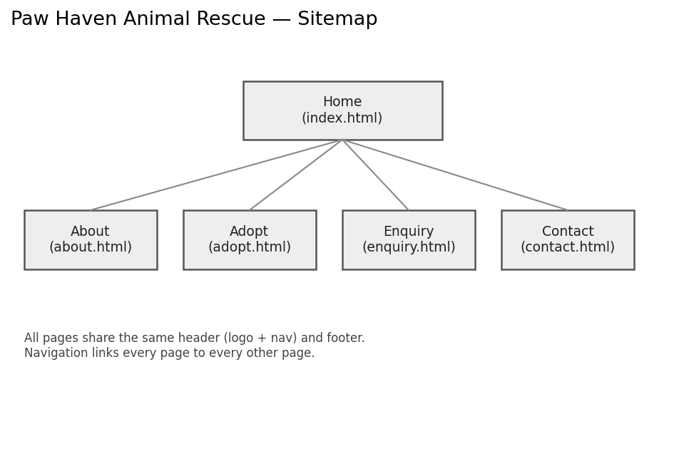

# Paw Haven Animal Rescue — Website Project

## Student Information
- Name: Donald Mudzani
- Student Number: ST10512213
- Module: Web Development (Introduction) — WEDE5020 / WED5112POE
- Institution: The Independent Institute of Education (The IIE), Rosebank College

## Project Links

- **Live website:** https://mudzani.github.io/ST10512213-WEDE51112-POE/
- **GitHub repository:** https://github.com/mudzani/ST10512213-WEDE51112-POE


## Project Overview
Paw Haven Animal Rescue is a fictional non-profit animal shelter based in Johannesburg,
selected as the subject organisation for this Portfolio of Evidence (POE). The project is a
5-page static website built progressively across three parts of the module: HTML foundation
(Part 1), CSS styling and responsive design (Part 2), and JavaScript functionality and SEO
(Part 3). This README documents the development across Parts 1, 2 and 3.

## Website Goals and Objectives
- Introduce the organisation and its animal-rescue purpose.
- Present animal profiles in a way that visitors can browse.
- Allow visitors to make adoption, volunteering and sponsorship enquiries.
- Provide contact information and general location references.
- Offer a consistent experience across desktop, tablet and mobile screen sizes.

**Key Performance Indicators:**
- Number of enquiry-form submissions per month.
- Number of volunteer sign-up enquiries per month.
- Time users spend browsing the adoptable-animals content.

## 3. Website Pages and Features
| Page | Purpose and functionality |
|---|---|
| `index.html` | Homepage introducing Paw Haven and directing visitors to key sections of the website. |
| `about.html` | Presents the fictional organisation's story, mission, vision and team information. Includes expandable information using native HTML disclosure elements. |
| `adopt.html` | Displays animal profiles and provides search, animal-type filtering, sorting, empty-results feedback and larger-image viewing. |
| `enquiry.html` | Provides an enquiry form for adoption, volunteering and sponsorship. Adoption enquiries can be linked to a selected animal. |
| `contact.html` | Provides contact information, general-area Google Maps searches and a contact form.

## Timeline and Milestones
- Week 1–2: Proposal drafting, research, and lecturer approval (Part 1).
- Week 3–4: Wireframes, sitemap, folder structure, and HTML foundation (Part 1).
- Following submission: CSS styling and responsive design (Part 2).
- Following submission: JavaScript functionality, forms, and SEO (Part 3).

## Part 1 Details

### Organisation Selection
Two proposals were developed and submitted for lecturer approval: **Paw Haven Animal
Rescue** (non-profit) and **Kelder & Vine** (small business). Paw Haven was selected as
the stronger option for the full POE, since its enquiry-form requirements, adoptable-animal
content, and future dynamic/search functionality (Part 3) map more directly onto the
module's rubric than a standard small-business catalogue site. See the Website Project
Proposal document for both proposals in full and the selection rationale.

### Content Research and Sourcing
- Organisational content (history, mission, vision, animal profiles) is original content
  written for this fictional organisation and does not require citation.

- See [page-content-sources.md](page-content-sources.md) for the full page-by-page
  breakdown of what is original versus sourced.
- No external text content has been copied from any source; all page copy is original.

### Sitemap


A 4-page hierarchy under a Home page, matching the file structure below. All pages link
to all other pages via a shared navigation menu.

### File and Folder Structure
```
ST10512213 WEDE51112 POE/
├── index.html
├── about.html
├── adopt.html
├── enquiry.html
├── contact.html
├── css/
│   └── style.css         
├── js/
│   └── script.js
├── images/
├── page-content-sources.md
├── image-source-audit.md
├── robots.txt
├── sitemap.xml
├── README.md
└── CHANGELOG.md
```

## Part 2 Details

### Working through Part 1 Feedback
Official Part 1 feedback was received and  has been addressed; see [CHANGELOG.md's](CHANGELOG.md's) "Part 1 Official Feedback Response" section
for the full breakdown mapped to each named rubric criterion (Website Structure and
Planning, Comments, Budget, Content Research and Sourcing, README, References). The two
most significant fixes were a misplaced sitemap (present in the file but not under a
proper section heading, which had scored 0/5) and a complete absence of code comments on
`about.html` (also 0/5) — both are corrected in this submission.

### External Stylesheet
All 5 pages are linked to a single external stylesheet, `css/style.css`, via
`<link rel="stylesheet" href="css/style.css">` in each page's `<head>`.

### CSS Styling for Desktop
`style.css` is organised into clearly labelled sections matching the rubric:
1. Reset / base style (universal box-sizing, base font, base colours)
2. Typography (heading font, body font, sizes)
3. Layout structure (Flexbox for the nav, the home-page highlight cards, and the
   adopt-page animal cards)
4. Decoration and colour (the terracotta/cream/forest-green palette from the Part 1
   proposal's Design and User Experience section)
5. Pseudo-classes (`:hover` on links and buttons, `:active` on buttons, `:focus` on
   form fields)

### Responsive Design
Two breakpoints are used: 768px (tablet) and 480px (mobile).
- **Layout:** the highlight cards and animal cards go from 4/3-per-row on desktop, to
  2-per-row on tablet, to 1-per-row on mobile.
- **Typography:** heading and body font sizes reduce slightly at each breakpoint.
- **Navigation:** the nav switches from a horizontal row to a vertical stack on mobile,
  with the logo above it instead of beside it.
- **Images:** all images use `max-width: 100%; height: auto;` so they scale within
  their container at every screen size, rather than a fixed pixel size.

Screenshot evidence of desktop (1200px), tablet (768px), and mobile (375px) views is in
the `evidence/` folder: `part2-desktop-home-1200px.png`, `part2-tablet-home-768px.png`,
`part2-mobile-home-375px.png`, `part2-tablet-adopt-768px.png`,
`part2-mobile-adopt-375px.png`, `part2-desktop-enquiry-1200px.png`.

## Part 3 Details  JavaScript, Forms, SEO and Publishing

### JavaScript functionality
- `js/script.js` contains the small client-side interactions used by the pages.
- The Adopt page lets visitors search profiles by name or description, filter by dog/cat, and sort by name or age.
- Selecting an animal's enquiry link preselects the adoption enquiry and animal on `enquiry.html`.
- Clicking an animal photo opens a larger image in a dialog. The dialog can be closed using its Close button or by clicking outside the image.
- The About page uses native HTML `details` and `summary` elements for simple expandable answers.

### Forms and validation
- `enquiry.html` validates the visitor's name, email, enquiry type, message, and the selected animal when the enquiry is about adoption.
- Both forms use a Google Apps Script web app as their form handler. Google Apps Script is Google's platform for running JavaScript in Google's cloud; a deployed web app can receive requests from a website and run server-side code. This is useful for this static GitHub Pages site because the site itself has no server to process form submissions.
- In `js/script.js`, `PAW_HAVEN_FORM_ENDPOINT` is the configuration point for the deployed web app URL. The form code collects the entered fields with `FormData`, converts them to URL-encoded data, adds a `formType`, and sends a POST request to that endpoint. The deployed Apps Script is expected to process the request; its server-side code and configuration are not included in this project, so its exact actions must be checked in the Apps Script project.
- **Recipient configuration needs verification.** The forms have a `data-recipient` value in their HTML. The JavaScript reads it only to decide whether to attempt submission and blocks placeholder values. Although that value is passed to the send function, the function does not add it to the request data or otherwise use it. Therefore the source code here does not show that the recipient is sent to or configured in the Apps Script. Check the Apps Script code and its deployment settings to confirm where messages or records go, and confirm the intended recipient there. Do not treat the HTML value as proof that an email address is connected.
- **Three separate outcomes:** browser-side validation checks that required fields have acceptable values; a request is then attempted to the configured Apps Script URL; successful email delivery is a further server-side outcome that this browser code cannot confirm. The code uses `fetch()` with `mode: 'no-cors'`. This gives JavaScript an opaque response: it cannot read the response body or HTTP status to confirm what the web app did. A resolved `fetch()` therefore does not prove that the Apps Script processed the data or delivered an email. The page's success message reports that the request was sent to the handler, not that an email arrived.
- To test the forms, first inspect the Apps Script server-side code and confirm its recipient or spreadsheet destination, then verify that the deployed web app URL in `PAW_HAVEN_FORM_ENDPOINT` points to the intended deployment and that its access settings allow the website request. Publish the site and submit a clearly identifiable test through both the Enquiry and Contact forms. Check the Apps Script executions/logs and the configured spreadsheet or recipient inbox (including spam) for each test. A browser success message alone is not delivery verification. Client-side validation improves usability; it is not server-side security.

### Maps and external services
- The Contact page embeds Google Maps searches for the general Randburg and Fourways areas, and provides links to open each area in Google Maps.
- The two street addresses and opening times are fictional project details. The embedded maps show the general areas, not verified premises or exact pins. The website must not be presented as a real operating shelter.

### Search engine optimisation
- Each HTML page has a unique title, a page-specific meta description, and relevant terms used naturally in page content.
- Heading levels, internal links, image alt text, and image paths have been reviewed.
- `robots.txt` and `sitemap.xml` have been added. Their absolute URLs assume the GitHub Pages address below; confirm or update these files after GitHub Pages publishes the site.
- Image files and scripts use local paths. Maps are loaded from Google Maps and therefore require an internet connection.
- No search ranking or traffic increase is claimed. Backlinks and social promotion require external actions and have not been completed as part of the local code changes.

### Responsive design and feedback corrections 
- Navigation now wraps on smaller screens and becomes a two-column link grid on narrow mobile screens.
- Content grids change to fewer columns as the screen gets narrower. Images scale within their containers.
- A skip link and visible keyboard focus styles have been added to help keyboard navigation.
- The case-sensitive animal image paths were corrected to match the actual filenames (`Whiskers.jpg`, `Nala.jpg`, and `Max.jpg`), which is important for GitHub Pages.
- Map images have been replaced with embedded map searches for two general location areas.


**Site is live at :** https://mudzani.github.io/ST10512213-WEDE51112-POE/

 
## Changelog
See [CHANGELOG.md](CHANGELOG.md).

## References
References specific to the two proposals are listed in full in the Website Project
Proposal document. All external sources used anywhere in Part 1 are compiled here:

**Domain pricing (Budget section of the proposal):**
xneelo. 2026. *Domain Name Search and Registration*. [Online]. Available at:
https://xneelo.co.za/domains/ [Accessed 11 August 2026].

**HTML syntax reference (used to learn standard formatting patterns, not to copy a
finished solution):**
W3Schools. n.d. *HTML Formatting Elements*. [Online]. Available at:
https://www.w3schools.com/html/html_formatting.asp [Accessed 14 August 2026].

**Wireframes (Figures 1–10 in the Website Project Proposal document):** These were developed with the assistance of an AI tool based on the project planning content, with draw.io used as a design tool: draw.io. n.d. *Online diagram software*. [Online]. Available at: https://www.drawio.com/ [Accessed 26 October 2026]. Disclose AI assistance according to the current IIE requirements.

**Website images — AI-generated original assets:**
Mudzani, D. 2026. *Paw Haven Animal Rescue logo*. Pretoria: Unpublished. (Generated with
the assistance of an AI image-generation tool for use as an original project asset.)

Mudzani, D. 2026. *Paw Haven main shelter illustration*. Pretoria: Unpublished. (Generated
with the assistance of an AI image-generation tool for use as an original project asset.)

Mudzani, D. 2026. *Paw Haven weekend adoption event venue illustration*. Pretoria:
Unpublished. (Generated with the assistance of an AI image-generation tool for use as an
original project asset.)

**Website images  photographs:**

- iStock by Getty Images. n.d. *Learning about Cat Care at an Animal Shelter* [Photograph]. Available at: https://www.istockphoto.com/photo/learning-about-cat-care-at-an-animal-shelter-gm2151854408-572911823 (Accessed 14 August 2026).
- One Tail at a Time. 2024. *Rescued puppy and injured kitten in foster care* [Photograph]. In: Perez, R. *Rescued Puppy and Injured Kitten Become Best Friends In Foster Care. Now, They Need A Forever Home*. Block Club Chicago, 30 August. Available at: https://blockclubchicago.org/2024/08/30/rescued-puppy-and-injured-kitten-become-best-friends-in-foster-care-now-they-need-a-forever-home/ (Accessed 14 August 2026).
- iStock by Getty Images. n.d. *Animal shelter images and stock photos*. Available at: https://www.istockphoto.com/search/2/image-film?phrase=animal+shelter (Accessed 14 August 2026). This is a search page, not proof of the source or licence for an individual image.

**Part 3  web development and SEO references:**

Mozilla. n.d. *Client-side form validation*. MDN Web Docs. [Online]. Available at: https://developer.mozilla.org/en-US/docs/Learn_web_development/Extensions/Forms/Form_validation [Accessed 26 October 2026].

Mozilla. n.d. *Using HTML form validation and the Constraint Validation API*. MDN Web Docs. [Online]. Available at: https://developer.mozilla.org/en-US/docs/Web/HTML/Guides/Constraint_validation [Accessed 26 October 2026].

Google. n.d. *Web apps*. Google Apps Script. [Online]. Available at: https://developers.google.com/apps-script/guides/web [Accessed 30 October 2026].

Google. n.d. *SEO Starter Guide*. Google Search Central. [Online]. Available at: https://developers.google.com/search/docs/fundamentals/seo-starter-guide [Accessed 26 October 2026].

GitHub. n.d. *What is GitHub Pages?*. GitHub Docs. [Online]. Available at: https://docs.github.com/en/pages/getting-started-with-github-pages/what-is-github-pages [Accessed 26 October 2026].

Google. n.d. *Google Maps URLs*. Google Maps Platform. [Online]. Available at: https://developers.google.com/maps/documentation/urls/get-started [Accessed 26 October 2026].

